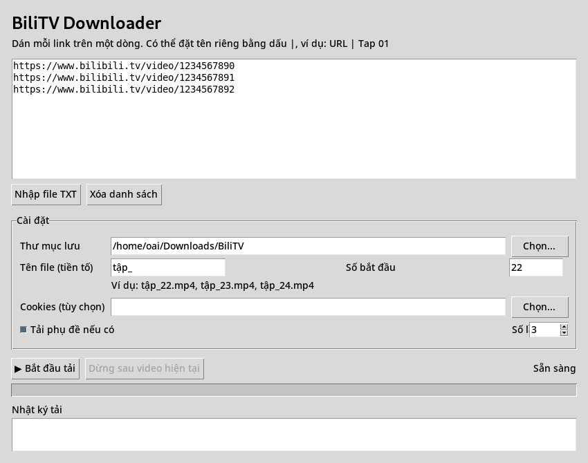

<div align="center">

# BiliTV Downloader — Python GUI & CLI

**Batch video downloads for Bilibili.tv with automatic episode naming, progress, subtitles, and retries.**

[](https://github.com/coritza198/BiliTV-Downloader-Python/releases/latest)
[](https://github.com/coritza198/BiliTV-Downloader-Python/actions/workflows/build-windows.yml)
[](LICENSE)

**[⬇ Download latest Windows EXE](https://github.com/coritza198/BiliTV-Downloader-Python/releases/latest)** · [Source code](https://github.com/coritza198/BiliTV-Downloader-Python) · [Report an issue](https://github.com/coritza198/BiliTV-Downloader-Python/issues)

</div>

> **Note:** This is an independent, unofficial project. Download only content you are authorized to access. The application does not bypass DRM or access restrictions. Availability depends on Bilibili.tv's API and region.

## GUI preview / Ảnh giao diện



*Screenshot captured from the Python Tkinter v1.2.0 interface with sample URLs; it does not demonstrate a completed download.*

## Features / Tính năng

| Feature | Description |
| --- | --- |
| GUI + CLI | Windows-friendly Tkinter interface and command-line mode |
| Batch downloads | Paste multiple URLs or import a `.txt` list |
| Episode numbering | Separate filename prefix and starting number: `tập_` + `22` → `tập_22.mp4`, `tập_23.mp4`... |
| Custom filenames | Use `URL \| filename` for an individual video (GUI) |
| Progress | Progress bar and transfer status |
| Retries | Configure 1–10 download attempts |
| Cookies | Optional `cookies.txt` for content you are permitted to access |
| Subtitles | Attempts to download subtitles exposed by the API |
| FFmpeg | Merges audio and video tracks |
| Windows EXE | Automated Windows builds through GitHub Actions |

## Quick start — Windows EXE

1. Open **[Latest Releases](https://github.com/coritza198/BiliTV-Downloader-Python/releases/latest)**.
2. Under **Assets**, download `BiliTV-Downloader-GUI.exe` (if available in the selected release).
3. Install [FFmpeg](https://ffmpeg.org/download.html) and add it to `PATH`, **or** place `ffmpeg.exe` next to the downloaded EXE.
4. Double-click `BiliTV-Downloader-GUI.exe`.
5. Paste one Bilibili.tv video URL per line, choose the output folder, set **Tên file (tiền tố)** and **Số bắt đầu**, then click **Bắt đầu tải**.

**Example:** Prefix `tập_`, starting number `22`, and three links produce:

```text
tập_22.mp4
tập_23.mp4
tập_24.mp4
```

To override an individual filename in the GUI:

```text
https://www.bilibili.tv/video/1234567890 | Tap 22
https://www.bilibili.tv/video/1234567891 | Tap 23
```

The URLs above are placeholders for illustrating the input format, not verified downloadable videos.

## Run from source / Chạy bằng Python

**Requirements:** Python 3.10+ (Python 3.12 recommended), pip, and FFmpeg.

```powershell
git clone https://github.com/coritza198/BiliTV-Downloader-Python.git
cd BiliTV-Downloader-Python
python -m pip install -r requirements.txt
ffmpeg -version
python bilitv_gui.py
```

On Windows you can also run `run_gui.bat` after installing dependencies.

### CLI

Create a `links.txt` file with one URL per line, then run:

```powershell
python bilitv_downloader.py --list links.txt --output "D:\Videos" --prefix Anime --subtitle --retry 3
```

To provide a cookies file:

```powershell
python bilitv_downloader.py --list links.txt --cookies cookies.txt
```

CLI filenames are generated from the prefix and sequence index. **The separate starting-number field is currently a GUI feature.** Use `python bilitv_downloader.py --help` to view all supported CLI flags.

## Cookies and privacy / Cookie và bảo mật

Cookies are optional. Use a cookies file only when necessary and only from your own authorized session. **Never commit or upload `cookies.txt` to GitHub**, share it in an issue, or include it in screenshots. Cookies may grant access to your account. Delete or rotate exposed session credentials immediately.

## Build your own EXE / Tự build EXE

On Windows, install Python and FFmpeg, then run:

```powershell
python -m pip install -r requirements-build.txt
.\build_gui_exe.bat
```

The GUI executable is generated at `dist\BiliTV-Downloader-GUI.exe`. To build the CLI executable, run `build_exe.bat`.

GitHub Actions also builds the Windows executables. To trigger a release from a **new** version tag:

```bash
git tag v1.3.0
git push origin v1.3.0
```

The release workflow must pass tests and finish successfully before assets appear. Do not reuse an existing tag without understanding the consequences.

## Troubleshooting / Xử lý lỗi

| Problem | What to check |
| --- | --- |
| `FFmpeg missing` | Run `ffmpeg -version`; add FFmpeg to PATH or put `ffmpeg.exe` beside the app |
| Download fails | Check the URL, network connection, content access, and GUI log |
| Subtitle not saved | Subtitles may not be exposed by the API |
| EXE missing from Release | Check the latest [Actions build](https://github.com/coritza198/BiliTV-Downloader-Python/actions) and Release assets |
| Cookie-related failure | Ensure the cookies file is current; do not publish it |
| Windows security warning | Download from this repository's Release page and review source/build workflow; unsigned EXEs may trigger warnings |

## Project files

- `bilitv_gui.py` — Tkinter GUI
- `bilitv_downloader.py` — CLI and download logic
- `tests/` — unit tests
- `.github/workflows/build-windows.yml` — Windows build and release workflow
- `build_gui_exe.bat` / `build_exe.bat` — local Windows build scripts

## License

Released under the [MIT License](LICENSE). Not affiliated with Bilibili.tv.
